# 🎨 Awesome Component Libraries & Modern UI Design

  

  
  
  
  
  

  <strong>Curated Directory of Top SaaS Platforms & Open-Source UI Component Libraries</strong> 
  <em>Production-Ready React & Next.js Components • Accessible WAI-ARIA Design Systems • Tailwind CSS Kits • Headless Primitives • Copy-Paste Registries</em>

---

## 📑 Table of Contents

- [🌟 Overview](#-overview)
- [📊 Sector Overview & Market Dynamics](#-sector-overview--market-dynamics)
- [🏢 SaaS & Hosted Commercial Platforms](#-saas--hosted-commercial-platforms)
- [💻 Open-Source GitHub Projects](#-open-source-github-projects)
- [🤝 How to Contribute](#-how-to-contribute)
- [📈 Star History](#-star-history)
- [💖 Support & Share](#-support--share)
- [⚖️ Disclaimer](#-disclaimer)

---

## 🌟 Overview

Welcome to the definitive **Component Libraries & Modern UI Design** ecosystem guide. Building polished, high-performance web applications requires accessible, responsive, composable UI building blocks. 

This repository tracks category leaders, fast-growing SaaS component marketplaces, and battle-tested open-source libraries across **React, Next.js, Vue, Svelte, Solid, and Tailwind CSS**. Whether you need unstyled accessible primitives (Radix UI, React Aria, Base UI), atomic copy-paste components (`shadcn/ui`, Magic UI, Islandcn), or turnkey enterprise design systems (Ant Design, Mantine, Material UI), you'll find the best options cataloged below.

---

## 📊 Sector Overview & Market Dynamics

The global component libraries and modern UI design system software market is estimated at approximately **$3.8B to $4.5B (2024–2026)**, expanding at a **~12.5% CAGR** propelled by cloud-native design systems and AI-assisted generative UI tooling. 

The sector is **moderately fragmented**—while no single vendor maintains an outright monopoly due to diverse frontend framework ecosystems (React, Vue, Svelte) and styling paradigms (Tailwind CSS, CSS-in-JS, Headless ARIA primitives), strong commercial and developer mindshare concentration exists around category heavyweights like Material UI (MUI), Tailwind Labs (Shopify), and Vercel/shadcn ecosystems.

---

## 🏢 SaaS & Hosted Commercial Platforms

Below is a curated comparison of leading commercial UI platforms, design systems, and block marketplaces. *Sorted by company scale / valuation / revenue in descending order.*

| Platform / Company | 🏢 Scale & Valuation / Revenue | 💳 Pricing (Starting Tier) | 🎁 Free Tier Limits / Evaluation | 📝 Overview & Description |
| :--- | :--- | :--- | :--- | :--- |
| **[Ant Design Pro](https://ant.design)** (backed by Ant Group / Alibaba) | **~$40.5B quarterly revenue** (Alibaba Group Q2 FY27) / **~$10.5B quarterly profit** (Ant Group) | **$149 one-time** (Official Figma Design System bundle; core framework is free MIT) | **Free forever MIT code library** (unlimited production use); free tier excludes official Figma UI master kits & enterprise cloud template bundles | 🚀 Enterprise-grade admin console ecosystem offering commercial scaffolded layouts, business components, and internationalized dashboard blueprints. |
| **[Tailwind Plus](https://tailwindcss.com)** (Tailwind Labs / Shopify) | **Acquired by Shopify** (Shopify: **~$11.56B revenue**, **~$210B+ market cap**; Tailwind peak mid-7 figure revenue) | **$149 one-time** (Starting license prior to Shopify acquisition; commercial catalog now bundled/closed to new retail signups) | **Free forever open-source Tailwind CSS core**; Tailwind Plus UI preview includes limited sample blocks per category (Application, Marketing, E-commerce) | 🎨 Official commercial UI kit from the creators of Tailwind CSS offering hundreds of professionally designed application UI, marketing, and e-commerce templates in HTML, React, and Vue. |
| **[Tremor Blocks](https://tremor.so)** (acquired by Vercel) | **Acquired by Vercel** (Vercel: **~$9.3B valuation**, **~$200M–$305M ARR**) | **Free / $0** (Commercial blocks open-sourced following Vercel acquisition) | **Free forever under MIT license** (unlimited production use across all 35+ dashboard blocks, charts, and KPI widgets without paywalls) | 📊 Commercial collection of polished analytics, KPI card, and financial dashboard UI blocks built on Tailwind CSS and open-source Tremor primitives. |
| **[MUI Store & MUI X Pro/Premium](https://mui.com)** (MUI / Material-UI) | **Bootstrapped, profitable** (90+ employees, ~15k+ paying enterprise customers, mid-7 to 8-figure revenue footprint) | **$299 / developer / year** (MUI X Pro annual subscription) | **Free forever open-source Community plan** (MIT license for core components & standard Data Grid); 30-day evaluation trial for Pro/Premium features in local dev | 🧩 Official Material UI marketplace and enterprise component tier featuring advanced data grids, date/time range pickers, charts, and commercial React/Next.js dashboard templates. |
| **[Relume](https://relume.io)** (Relume Technologies) | **Bootstrapped** (est. **~$3.3M ARR**, 500k+ global design users) | **$18 / user / month** (billed annually at $216/year for Starter Plan; Pro at $40/month) | **Free forever plan limited to 1 project & 1 page**, export restricted to Figma only (Webflow/React export locked), branded hosting badge, and ~1 small site AI generation cap | 🤖 AI-powered site builder and massive component library (1,000+ Webflow, Figma, and React/Tailwind components) engineered for rapid wireframing and marketing site production. |
| **[HeroUI Pro](https://heroui.pro)** (formerly NextUI - HeroUI Inc.) | **Y Combinator backed (YC S24)** (Funded pre-seed/seed, rapid developer growth) | **$299 one-time** (Perpetual Web Hero or Mobile Hero license; $399 Super Hero bundle) | **Free forever open-source HeroUI core library** (unlimited MIT components); Pro templates, chat/AI components, and MCP tools require a paid license | ✨ Commercial library of 200+ responsive, accessible Tailwind CSS and Framer Motion UI blocks built on the open-source HeroUI component system. |
| **[Flowbite Pro](https://flowbite.com)** (Themesberg) | **Bootstrapped & profitable** (Independent studio, millions of global downloads) | **$299 one-time** (Developer Edition lifetime license; Designer Figma Edition at $169) | **Free forever MIT open-source edition** (core HTML/Tailwind components & single basic dashboard page); Pro blocks, Figma design files, and e-commerce kits require paid license | 📐 Commercial design system and UI kit extending open-source Flowbite with Figma variables, dashboard templates, e-commerce blocks, and application UI sections. |
| **[Chakra UI Pro](https://chakra-ui.com)** (Chakra Systems) | **Bootstrapped & community-sponsored** (Independent developer studio, millions of npm downloads) | **$299 one-time** (Personal license lifetime access; $899 Team license) | **Free forever open-source core Chakra UI library** (unlimited commercial projects under MIT); 330+ pre-designed Pro marketing and application blocks require paid license | ⚡ Commercial suite of responsive, accessible, multi-theme marketing and application UI blocks built directly on top of open-source Chakra UI. |
| **[Shadcnblocks / Origin UI Pro](https://shadcnblocks.com)** (shadcn ecosystem partners) | **Bootstrapped / Indie-led** (Independent commercial registries built around the shadcn ecosystem) | **$79 one-time** (Starting Pro lifetime access for Shadcnblocks; Origin UI core components remain 100% free MIT) | **Free forever tier with ~17 to 50+ basic blocks**; access to complete library of 400+ marketing sections, full templates, and Figma assets requires paid upgrade | 🧱 Ecosystem of commercial block marketplaces and SaaS starter kits built around the open-source `shadcn/ui` CLI registry specification. |

---

## 💻 Open-Source GitHub Projects

Explore the top open-source UI libraries, headless primitives, and component registries. Each repository features a real-time star badge linking directly to its stargazer community. *Sorted by star count in descending order.*

1. **[shadcn/ui](https://github.com/shadcn-ui/ui)**   
   ✨ Flagship open-source collection of beautifully designed, accessible, copy-paste React components built with Tailwind CSS and Radix/Base UI primitives—owned directly in your codebase.

2. **[Ant Design](https://github.com/ant-design/ant-design)**   
   🏛️ Enterprise-class open-source React UI design language and component library featuring a massive suite of data tables, forms, tree selects, and admin layouts.

3. **[Material UI](https://github.com/mui/material-ui)**   
   📦 Industry-standard open-source React implementation of Google's Material Design with extensive theming, Emotion/Pigment CSS styling, and enterprise adoption.

4. **[daisyUI](https://github.com/saadeghi/daisyui)**   
   🌼 Most popular component library for Tailwind CSS, adding clean semantic utility classes (`btn`, `card`, `modal`) without bloat or JavaScript dependencies.

5. **[Tabler](https://github.com/tabler/tabler)**   
   📊 Free and open-source HTML dashboard UI kit and application template built with modern web standards, featuring hundreds of responsive components and widgets.

6. **[Chakra UI](https://github.com/chakra-ui/chakra-ui)**   
   ⚡ Simple, modular, and accessible React component library offering intuitive style props, semantic tokens, and Ark UI state-machine primitives.

7. **[Mantine](https://github.com/mantinedev/mantine)**   
   🛡️ Comprehensive, batteries-included open-source React component and hooks library featuring 100+ customizable components, forms, rich-text editors, and charts with native dark mode.

8. **[HeroUI](https://github.com/heroui-inc/heroui)** *(formerly NextUI)*   
   🚀 Modern, fast open-source React UI library built on Tailwind CSS and React Aria featuring smooth animations, automatic dark mode, and zero runtime CSS overhead.

9. **[Headless UI](https://github.com/tailwindlabs/headlessui)**   
   🧩 Completely unstyled, fully accessible UI components designed to integrate seamlessly with Tailwind CSS across React and Vue.

10. **[Magic UI](https://github.com/magicuidesign/magicui)**   
    🪄 150+ free and open-source animated UI components and landing page blocks built with React, Typescript, Tailwind CSS, and Framer Motion.

11. **[Radix UI Primitives](https://github.com/radix-ui/primitives)**   
    🎯 Unstyled, accessible, WAI-ARIA-compliant open-source React UI primitives (dialogs, dropdowns, popovers, tabs, tooltips) powering modern design systems.

12. **[Taxonomy](https://github.com/shadcn-ui/taxonomy)**   
    🏗️ Open-source full-stack application built using the new Next.js App Router, Server Components, and shadcn/ui design primitives.

13. **[React Aria](https://github.com/adobe/react-spectrum)**   
    🌐 Adobe's open-source accessibility-first UI primitives and hooks with battle-tested keyboard navigation, internationalization, and touch interactions.

14. **[Base UI](https://github.com/mui/base-ui)**   
    📐 Open-source library of unstyled, accessible React UI components and hooks maintained by the creators of Radix, Floating UI, and Material UI.

15. **[shadcn-vue](https://github.com/unovue/shadcn-vue)**   
    💚 Vue, Nuxt, and Radix Vue port of shadcn/ui, bringing copy-pasteable accessible components to the Vue ecosystem.

16. **[Flowbite](https://github.com/themesberg/flowbite)**   
    🌊 Open-source library of UI components built with the utility-first classes of Tailwind CSS, with support for interactive JS, React, and Vue.

17. **[shadcn-svelte](https://github.com/huntabyte/shadcn-svelte)**   
    🧡 Svelte port of shadcn/ui built on Bits UI and Tailwind CSS for seamless integration into SvelteKit applications.

18. **[Motion Primitives](https://github.com/ibelick/motion-primitives)**   
    🎬 Advanced open-source animated React UI components and micro-interactions built with Tailwind CSS and Framer Motion.

19. **[Ark UI](https://github.com/chakra-ui/ark)**   
    🏹 Headless UI component library powered by state machines, offering consistent multi-framework accessibility across React, Vue, and Solid.

20. **[Tremor](https://github.com/tremorlabs/tremor)**   
    📉 Open-source React library built on Tailwind CSS and Recharts providing 35+ clean, copy-pasteable dashboard components, KPI cards, sparklines, and area/bar charts.

21. **[Park UI](https://github.com/cschroeter/park-ui)**   
    🏞️ Multi-framework open-source design system built on Ark UI and Panda CSS / Tailwind CSS with copy-paste CLI workflows.

22. **[islandcn](https://github.com/opencoredev/islandcn)**   
    🏝️ Modular, modern UI component library and registry inspired by `shadcn/ui`, engineered for clean, copy-pasteable web interface primitives.

---

## 🤝 How to Contribute

We welcome community contributions to keep this ecosystem comprehensive, accurate, and up-to-date! 🌟

1. 🍴 **Fork the repository** on GitHub.
2. 🌿 **Create a new branch** (`git checkout -b add-my-component-library`).
3. 📝 **Add or update entries** in `README.md` following the existing format. Please ensure:
   - Factual descriptions with proper links to official sites or repositories.
   - For SaaS products, include exact pricing and free tier/trial limits.
   - For open-source projects, include the proper repository star badge.
4. 🚀 **Commit your changes** (`git commit -m "Add Amazing UI Library"`).
5. 📤 **Push to your branch** (`git push origin add-my-component-library`).
6. 📬 **Submit a Pull Request** with a brief summary of what you've added or changed.

---

## 📈 Star History

---

## 💖 Support & Share

Thank you so much for exploring and using this curated guide! 🙏 If you find this directory valuable for your projects or team, please consider supporting the project:

- ⭐ **Star this repository** to help other developers and designers discover it.
- 🍴 **Fork & Share** it with your engineering team, design community, or on X/Twitter, LinkedIn, and Reddit.
- ☕ **Buy me a coffee / Sponsor**: If you'd like to support ongoing open-source maintenance and curated research, consider sponsoring through the [GitHub Sponsor Dashboard](https://github.com/sponsors/ishandutta2007) — every coffee helps keep this repository fresh, accurate, and up to date!

---

## ⚖️ Disclaimer

- 📌 This is an independent, **community-curated** list — inclusion does not represent an endorsement or sponsorship.
- ♿ Always verify custom and copy-paste UI components for accessibility compliance (keyboard navigation, screen-reader ARIA semantics, and WCAG color contrast) prior to shipping to production.
- 📜 Check commercial licensing terms before redistributing paid UI kits or proprietary templates inside open-source repositories or client deliverables.

---

  <strong>Crafted with ❤️ for frontend engineers, UI/UX designers, design-system architects, and open-source creators.</strong> 
  <em>Let's make modern web UI design and component engineering more open, accessible, and composable.</em>

